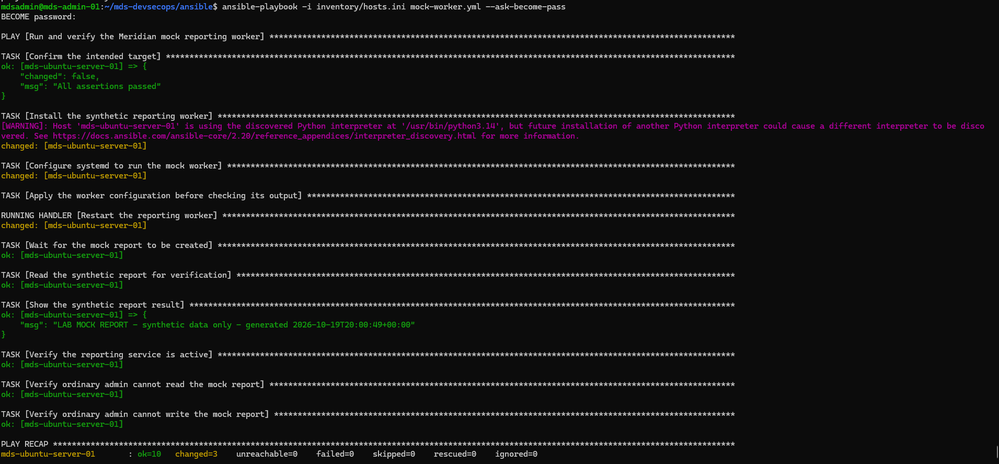
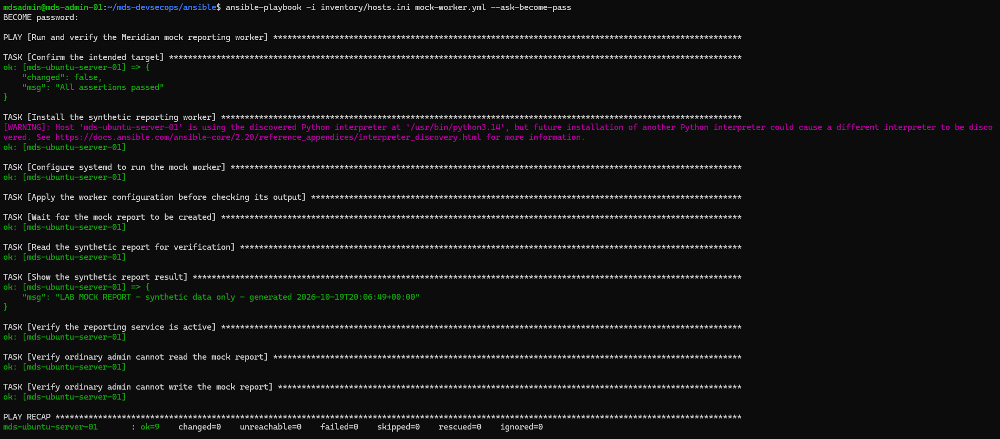

# Project 1a / 11 — The Meridian reporting server

**An existing server. An undisclosed fault. A controlled investigation.**

Meridian Digital Services is fictional. This project documents a reactive DevSecOps exercise on an isolated Ubuntu reporting server that was already running when the investigation began. The goal was to discover unsafe access, explain the risk, automate proportionate fixes, and prove the reporting workload still ran. All customer records and report output in the lab were synthetic.

> **Portfolio claim:** I assessed an existing Linux service with native tools and Lynis, used Ansible to restrict its identity and data access, and verified both the allowed and denied paths with a synthetic reporting worker.

## The three-part lab

```text
My Windows workstation
└── WSL: SSH entry point
    └── mds-admin-01: Ansible control node
        └── SSH over an isolated VirtualBox internal network
            └── mds-ubuntu-server-01: target reporting server
```

There were **two Ubuntu server VMs**: the admin server and the target. WSL was my workstation's entry point for SSH to the admin server; it was not a third server. The admin VM held the Ansible inventory and ran the playbooks against the target VM. The target hosted the reporting service and synthetic data.

This separation mirrors a common operational pattern: engineers work from a workstation or management host, while configuration automation connects to managed servers over SSH. It also meant I could validate the target from a separate control node, keep the automation off the workload host, and check that management access and the service survived each change. The VirtualBox internal network kept the exercise isolated; its addresses are lab-only.

## The scenario and the role of AI

The target was **not a fresh server awaiting a standard build**. An AI-assisted lab provisioning script created a deliberately insecure reporting workload and concealed the planted findings during the blind assessment. My task was to investigate the resulting state rather than follow a supplied list of weaknesses. This was a controlled simulation of the risk of accepting generated infrastructure changes without reviewing their effect; it was **not evidence of a real-world intrusion or malicious AI attack**.

AI also helped draft and explain parts of the remediation. I checked the commands, permissions, service state, and Ansible results in the lab. The evidence below distinguishes what was observed from what is merely planned.

## Investigation → control → proof

| Stage | What I did | Why it mattered |
| --- | --- | --- |
| 1. Establish a baseline | Inspected the service, process identity, file modes, ownership and Lynis findings. | A scanner points to areas to investigate; the operating system's actual state determines the risk. |
| 2. Trace access | Checked who could read or write the customer file, logs and exported report. | World-writable or world-readable paths could expose or change synthetic customer information. |
| 3. Create a service identity | Used Ansible to create `mds-reports` as a non-login system account and run the worker under it. | The workload no longer depended on a generic identity; its permissions could be scoped to its job. |
| 4. Limit the service | Applied `NoNewPrivileges`, `UMask=0027`, `PrivateTmp`, `ProtectHome` and `ProtectSystem=strict`, with explicit writable paths. | Systemd restrictions reduced the service's ability to gain privileges or write outside its required directories. |
| 5. Restrict data | Set `customers.csv` and the report/log files to owner-only `0600`; set the log and archive directories to `0700`, owned by `mds-reports`. | The worker retained required access while an ordinary account could not read or alter those files. |
| 6. Exercise the controls | Replaced the placeholder `sleep infinity` process with a synthetic worker that produced a mock report and log entry. | A running service alone would not show that the hardened worker could still perform its intended write operations. |
| 7. Re-run and verify | Checked service activity, expected access denials, generated output and a second Ansible run with `changed=0`. | The controls were testable and the automation converged without repeatedly changing the target. |

### A concrete before/after

The lab began with `/srv/mds/records/customers.csv` owned by root and mode `0666`: any local user could write to it. Ansible changed it to `mds-reports:mds-reports` and `0600`. Verification showed the reporting identity could read and write, while ordinary `mdsadmin` access checks were denied. Administrative override remained possible through controlled sudo/root access.

The original reporting unit also used permissive settings such as `UMask=0000`, `NoNewPrivileges=no`, and no systemd filesystem protections. The Ansible drop-in changed the effective service settings while keeping it active. `ReadWritePaths` allowed the worker's records, logs and archive locations under `ProtectSystem=strict`.

## Evidence

### Initial run

The first Ansible run installed and started the synthetic worker, produced its report, and passed both ordinary-admin denial checks. It completed with `ok=10 changed=3 failed=0`.



### Idempotent rerun

The second run verified the same output and access controls with `changed=0`, showing Ansible found the target already in the requested state. The text transcript is available [here](evidence/mock-worker-idempotent-run.txt).


- [Hardening verification record](evidence/hardening-verification.md): captured lab versions, current service properties, file permissions, and successful playbook summaries.
- [Findings and remediation record](docs/findings-and-remediation.md): evidence, risk, control, verification, and scope decisions for each finding.
- The published playbooks were copied from `mds-admin-01` as separate YAML files after their SHA-256 checksums were matched. The earlier preflight-only draft remains outside this repository.

## Step-by-step walkthrough

The [full lab walkthrough](docs/step-by-step-lab-walkthrough.md) follows the work from WSL and Lynis baseline collection through Ansible hardening, verification, and evidence capture. It includes the terminal commands and explains their purpose, including the Lynis ownership check and why Ansible privilege escalation is needed for `runuser` tests.

## Repository map

```text
README.md                         This case study, architecture and run instructions
docs/findings-and-remediation.md  Evidence-to-control record
docs/step-by-step-lab-walkthrough.md Commands and full lab sequence
evidence/                         Sanitized verification output and two screenshots
ansible/                          Final playbooks copied from the admin server
  harden.yml                      Reporting identity, systemd and customer file
  data-files.yml                  Log and archive permissions and writable paths
  mock-worker.yml                 Synthetic workload and runtime checks
  inventory/hosts.ini.example     Safe inventory example without credentials
```

The inventory example uses placeholders rather than keys, passwords or the live inventory file. No real customer data, private keys, credentials, raw provisioning payload, or hidden exercise answers belong in this portfolio repository. The three playbooks were copied from `mds-admin-01`; SHA-256 checksums matched the source files.


## Run the playbooks

From the Ansible control node, copy `inventory/hosts.ini.example` to `inventory/hosts.ini`, then replace the example SSH key path with the key path already configured for your lab. Keep the real inventory and private key out of Git.

Run the playbooks in this order:

```sh
cd ~/mds-devsecops/ansible
ansible-playbook -i inventory/hosts.ini harden.yml --ask-become-pass
ansible-playbook -i inventory/hosts.ini data-files.yml --ask-become-pass
ansible-playbook -i inventory/hosts.ini mock-worker.yml --ask-become-pass
```

The first playbook creates the restricted service identity, applies systemd limits, protects the customer record file, and checks who can access it. The second permits the service's log and archive paths and locks down their ownership and modes. The third installs the synthetic reporting worker, switches the systemd unit to it, and checks the generated report, service state, and ordinary-admin access. `--ask-become-pass` makes Ansible prompt for the sudo password instead of storing it in the command or inventory.

These playbooks change the lab target. Read each task before running it, confirm the inventory points at the intended isolated VM, and keep access to the VM console available for recovery.

## Scope and limits

This is **Project 1a: reactive Linux hardening**. Lynis supported the baseline investigation, but its aggregate score is not used as the measure of success; it covers many checks outside this exercise. The direct permission, systemd, service and idempotence evidence supports the narrower claims above. SSH and firewall hardening, auditd and a production reporting application were **not** completed in this project. Project 1b is planned as a separate, proactive cloud-server hardening exercise.

The synthetic worker proves that a constrained process can write its required outputs in this lab. It does not establish production readiness for a real reporting application.
