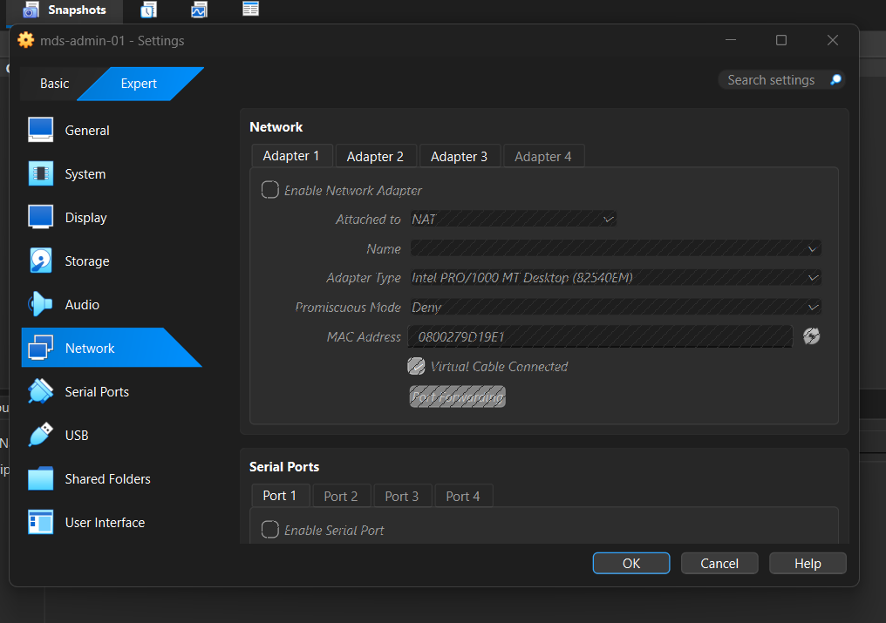
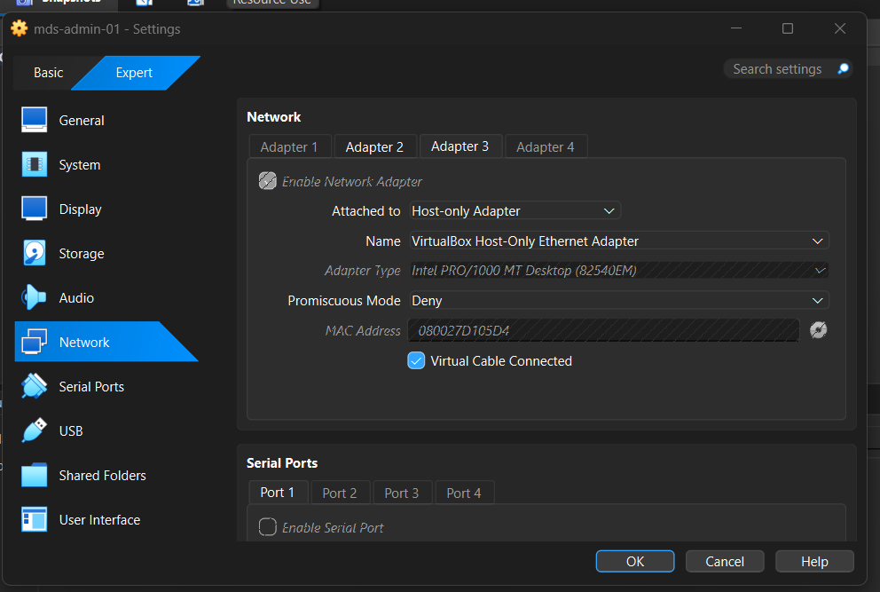
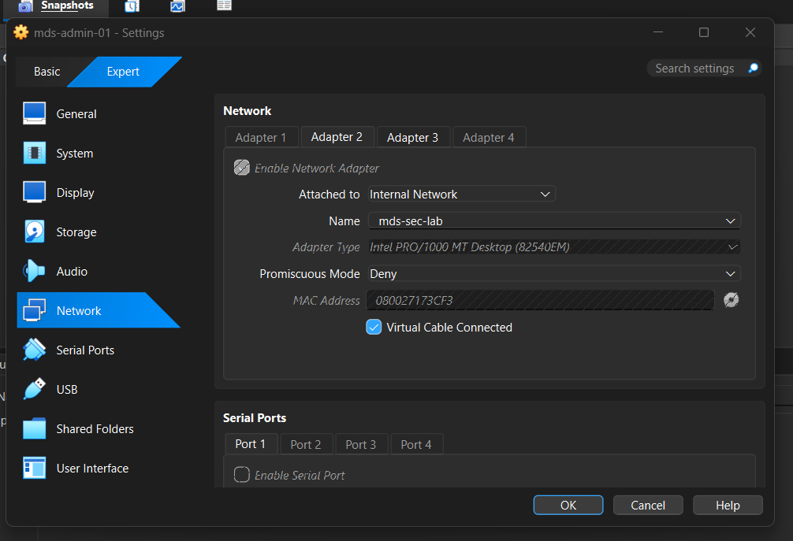
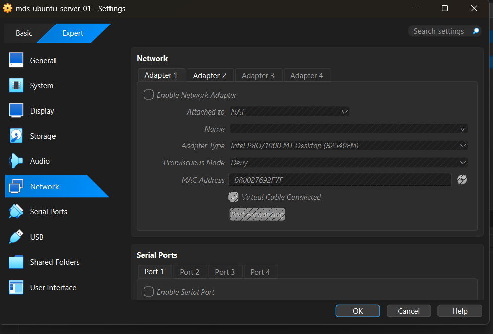
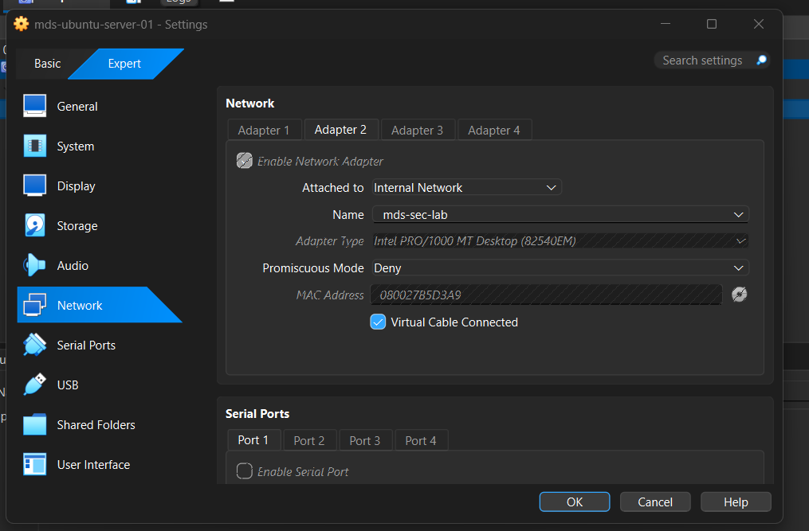

# VirtualBox network settings evidence

These screenshots document the adapter configuration used for the local two-VM lab. They complement the guest-level addresses recorded in the project; they do not prove guest routes, IP forwarding, or successful connectivity by themselves.

## Admin VM: `mds-admin-01`

Adapter 1 was attached to NAT but disabled. Adapter 2 was enabled as a Host-only Adapter named `VirtualBox Host-Only Ethernet Adapter`. Adapter 3 was enabled on the Internal Network named `mds-sec-lab`.

The host-only adapter provided the management path to the admin VM at 192.168.56.101. The internal adapter placed the admin VM on the target-side lab network. The induction archive expects the control node to use 192.168.77.20, but the adapter screenshots do not confirm that guest address.

## Target VM: `mds-ubuntu-server-01`

Adapter 1 was attached to NAT but disabled. Adapter 2 was enabled on the same mds-sec-lab Internal Network as the admin VM. The Ansible inventory records the target address as 192.168.77.10; the adapter screenshots do not display the guest address.

The screenshots show the target's Adapter 2 on the internal lab network and its NAT Adapter 1 disabled. They do not show Adapters 3 or 4, so the complete target adapter configuration cannot be inferred from these images. The host-only management adapter shown on the admin VM separated the laptop-to-admin path from the pictured VM-to-VM segment.

## Relationship to the induction ZIP

The screenshots show admin Adapters 2 and 3 enabled; Adapter 4 is not shown, so at least two active adapters are visible. If these settings were active at deployment time, the one-adapter preflight would reject the admin VM before running the deployment playbook.

